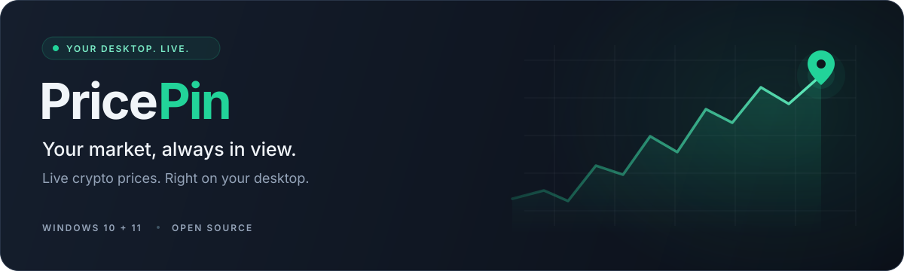

<p align="center">
  
</p>

<div align="center">

# PricePin

**Your market, always in view.**

Live crypto prices, charts and alerts in a customisable Windows desktop widget.  
Pin your coins, follow your portfolio, and keep your workspace yours.

[](https://github.com/4U0/PricePin-Next/releases/latest)
[](https://github.com/4U0/PricePin-Next/actions/workflows/build.yml)
[](LICENSE)

**Windows 10 & 11** &nbsp; · &nbsp; **x64 & ARM64** &nbsp; · &nbsp; **English & Türkçe**

[Download](#download) &nbsp; / &nbsp; [Features](#features) &nbsp; / &nbsp; [Get started](#getting-started) &nbsp; / &nbsp; [Shortcuts](#keyboard-and-mouse) &nbsp; / &nbsp; [Build](#build-from-source)

</div>

---

## Why PricePin

| Keep the market close | Make it your own | Keep your data local |
| :--- | :--- | :--- |
| Streaming prices from Binance, Coinbase and Kraken, with automatic failover. | Floating cards or a scrolling ticker. Up to eight widgets, each with its own setup. | No account, API key or telemetry. Settings and holdings stay on your PC. |

## Download

Choose your download from the **[latest release](https://github.com/4U0/PricePin-Next/releases/latest)**:

| Download | Best for | Updates |
| :--- | :--- | :--- |
| **[Windows x64 installer](https://github.com/4U0/PricePin-Next/releases/latest/download/PricePin-win-x64-Setup.exe)** | Most Intel and AMD PCs | Automatic |
| **[Windows ARM64 installer](https://github.com/4U0/PricePin-Next/releases/latest/download/PricePin-win-arm64-Setup.exe)** | ARM PCs, including Snapdragon laptops | Automatic |
| **[Portable x64](https://github.com/4U0/PricePin-Next/releases/latest/download/PricePin-win-x64-Portable.zip)** · **[Portable ARM64](https://github.com/4U0/PricePin-Next/releases/latest/download/PricePin-win-arm64-Portable.zip)** | No installation; unzip and run `PricePin.exe` | Manual |

The installers work for your user only, require no admin rights, and add a Start menu shortcut.

> [!NOTE]
> The installer isn't code-signed yet, so Windows SmartScreen may warn the first time. Click **More info → Run anyway**.

To remove PricePin, uninstall it from *Settings → Apps* like any other app. Your settings stay in `%AppData%\PricePin` in case you come back; delete that folder to remove them too.

**Want to try unreleased changes?** Every build on the [Actions tab](https://github.com/4U0/PricePin-Next/actions/workflows/build.yml) has a test installer under *Artifacts*.

## Getting started

1. Run the installer. A widget with the top coins appears and the tray icon shows up in the notification area.
2. **Right-click the widget** (or the tray icon) and open **Settings** to add, remove or reorder coins, change the currency, or switch to the ticker bar.
3. **Double-click a coin** to open its chart, where you can also set an alert or add it to your portfolio.

### Keyboard and mouse

| Action | How |
| --- | --- |
| Show or hide all widgets | <kbd>Ctrl</kbd>+<kbd>Alt</kbd>+<kbd>P</kbd> |
| Toggle click-through | <kbd>Ctrl</kbd>+<kbd>Alt</kbd>+<kbd>T</kbd> |
| Toggle privacy mode | <kbd>Ctrl</kbd>+<kbd>Alt</kbd>+<kbd>H</kbd> |
| Quick search | <kbd>Ctrl</kbd>+<kbd>Alt</kbd>+<kbd>K</kbd> |
| Change opacity | <kbd>Ctrl</kbd> + mouse wheel over a widget |
| Place freely without snapping | Hold <kbd>Shift</kbd> while dragging |
| Open a coin's chart | Double-click the coin |
| Show or hide from the tray | Left-click the tray icon (right-click for the menu) |

All four global shortcuts can be changed in *Settings → General*.

## Features

| | What you can do |
| :--- | :--- |
| **📌 Desktop widgets** | Choose floating cards or a scrolling ticker, tune opacity, and enable click-through. |
| **⚡ Live markets** | Follow exchange prices and DEX tokens, with sparklines and five display currencies. |
| **🔎 Search & charts** | Look up coins from anywhere, convert amounts, and explore charts from 1D to 1Y. |
| **🔔 Alerts & portfolio** | Set price or percentage alerts, track holdings and profit/loss, and blur amounts for screen sharing. |
| **📰 Beyond the price** | Follow crypto headlines, whale trades, liquidations, Bitcoin fees and Ethereum gas. |
| **🎨 Personal touches** | Pick dark, light or system themes, eight accent colours, three sizes, and English or Turkish. |

**Explore the details**

<details>
<summary><strong>Widgets and layouts</strong></summary>

- **Card list** that you drag anywhere and that snaps to screen edges (hold <kbd>Shift</kbd> to place it freely)
- **Ticker bar** that scrolls prices across the top or bottom of the screen, can reserve that space so maximised windows don't cover it, pauses while you hover it, and steps aside for full-screen apps
- **Up to 8 widgets at once**, each with its own coins, layout, size, opacity and position
- Stay on top, opacity from 20% to 100%, click-through and lock position
- Remembers where it was, and moves back on screen if a monitor is unplugged
- Only one copy runs at a time; launching it again shows the existing widget
- Sharp on high-DPI and mixed-scaling multi-monitor setups

</details>

<details>
<summary><strong>Live prices</strong></summary>

- WebSocket feeds from **Binance, Coinbase and Kraken**, with automatic failover and REST polling as a last resort
- Reconnects on its own and notices a silent connection within 20 seconds
- Status pill showing LIVE, RECONNECTING, DELAYED or OFFLINE (hover it for details)
- Real coin logos, 24h sparklines, green and red flashes on every move, and a live 24h change
- Hover a coin for its 24h high, low and volume
- Prices in **USD, USDT, EUR, TRY or GBP**
- Change over the **last hour, 24 hours or 7 days**, per widget, with a sparkline to match

</details>

<details>
<summary><strong>Any token, on any chain</strong></summary>

- Search by name or paste a **contract address** to add tokens from decentralised exchanges on Solana, Base, BNB Chain, Ethereum, Arbitrum and dozens more chains
- Prices from DexScreener every few seconds, charts and sparklines from GeckoTerminal
- Hover a token for its chain, market cap and liquidity; tiny, illiquid pools are left out of searches
- Works with alerts, the portfolio and the tray icon like any other coin

</details>

<details>
<summary><strong>Quick search</strong></summary>

- Press <kbd>Ctrl</kbd>+<kbd>Alt</kbd>+<kbd>K</kbd> anywhere to look up any coin's live price and sparkline
- Built-in converter: type an amount of the coin or of your currency
- Open the chart, add it to a widget, set an alert or add it to your portfolio straight from there

</details>

<details>
<summary><strong>Charts and market</strong></summary>

- **Coin charts:** double-click any coin for a 1D, 1W, 1M or 1Y chart that follows the live price. It has a crosshair, plus the range's high, low, change and volume
- **Market overview:** total market cap and its 24h change, BTC and ETH dominance, the Fear & Greed Index, and your best and worst coins today

</details>

<details>
<summary><strong>News, whales and fees</strong></summary>

- **Crypto headlines** from CoinDesk, Cointelegraph, Decrypt, The Block and Bitcoin Magazine, each tagged with the coins it mentions. Mix them into a ticker bar or show one at a time under a list widget, and click one to read it. Filter to news about your own coins, and optionally get notified about news on coins you hold
- **Whale and liquidation radar:** big spot trades on Binance (or Coinbase) and futures liquidations on Binance and Bybit as they happen, with last-hour totals of longs and shorts wiped out. Pick the sizes that count, and get notified about very large ones
- **Network fees:** Bitcoin fees in sat/vB for the next block, 30 minutes, an hour or economy, and Ethereum gas in gwei, with what a payment costs in your currency. Show them in a widget, and get notified when gas or the Bitcoin fee falls below a level you choose

</details>

<details>
<summary><strong>Alerts</strong></summary>

- Alerts when a coin goes **above or below a price**, or **rises or falls by a percentage** in 24h
- Windows notifications with an optional sound, firing once or every time
- **Live price in the tray icon** for a coin you choose, green or red with the 24h move

</details>

<details>
<summary><strong>Portfolio and privacy</strong></summary>

- Enter what you hold, and optionally what you paid, to see each holding's value, a live total, today's change and profit or loss
- **Privacy mode** blurs every amount for screen sharing and streaming while prices stay visible

</details>

<details>
<summary><strong>Look and feel</strong></summary>

- Dark, light or follow-Windows theme, eight accent colours and three sizes
- Options to hide coin names, sparklines or headings
- **English and Türkçe**, following your Windows language or chosen in Settings
- Automatic background updates, start with Windows, and a tray icon

</details>

## Privacy

PricePin has no account, no telemetry and no analytics. Market data comes from the public sources listed below; the app also checks GitHub for updates. Your coins, alerts and holdings are stored in a settings file on your PC and nowhere else.

## Data sources

<details>
<summary><strong>Providers, attribution and connection diagnostics</strong></summary>

| Source | Used for |
| --- | --- |
| Binance | Live prices (WebSocket), 24h history and charts. USD is shown using USDT pairs. Not available in some regions, so PricePin moves on automatically. |
| Coinbase | Live prices (WebSocket), REST fallback, 24h history and charts |
| Kraken | Live prices (WebSocket), 24h history and charts |
| [cryptocurrency-icons](https://github.com/spothq/cryptocurrency-icons) (CC0) | Coin logos. Popular coins are bundled; others download once and are cached. |
| CoinGecko | Logos for newer coins, plus market cap and dominance from its public `/global` endpoint |
| [alternative.me](https://alternative.me/crypto/fear-and-greed-index/) | Fear & Greed Index |
| [DexScreener](https://dexscreener.com) | Prices, search and logos for tokens on decentralised exchanges |
| [GeckoTerminal](https://www.geckoterminal.com) | Charts and sparklines for tokens on decentralised exchanges |
| Coinbase, [open.er-api.com](https://www.exchangerate-api.com/docs/free) | Dollar exchange rates, to show DEX token prices in EUR, TRY or GBP |
| CoinDesk, Cointelegraph, Decrypt, The Block, Bitcoin Magazine | Headlines, from their public RSS feeds |
| Binance, Coinbase, Bybit | Whale trades (Binance spot, or Coinbase where Binance is blocked) and liquidations (Binance and Bybit futures) for the radar |
| [mempool.space](https://mempool.space) | Bitcoin fee rates |
| Public Ethereum nodes ([PublicNode](https://ethereum-rpc.publicnode.com), dRPC, 1RPC, LlamaRPC) | Ethereum gas |

All of these are public endpoints, so no account or API key is needed. To check which sources work from your network:

```powershell
dotnet run --project tools/FeedProbe -- 15 BTC ETH SOL
```

</details>

## Files

| Path | What's there |
| --- | --- |
| `%AppData%\PricePin\settings.json` | Your settings, alerts and holdings. Delete it to reset everything. |
| `%AppData%\PricePin\crash.log` | Unexpected errors, if any |
| `%LocalAppData%\PricePin` | Cached logos and coin lists |

## Build from source

Requires the [.NET 10 SDK](https://dotnet.microsoft.com/download) on Windows 10 or 11.

```powershell
git clone https://github.com/4U0/PricePin-Next.git
cd PricePin-Next
dotnet run --project src/PricePin
```

Run the tests:

```powershell
dotnet test
```

Single-file release build:

```powershell
dotnet publish src/PricePin -c Release -r win-x64 --self-contained `
  -p:PublishSingleFile=true -p:IncludeNativeLibrariesForSelfExtract=true -p:EnableCompressionInSingleFile=true
```

### Project layout

```text
src/PricePin          WPF app: windows, view models, controls, themes, strings
src/PricePin.Core     Feeds, failover, alerts, portfolio, charts, news, radar, fees and settings (no UI)
tests/                Unit tests for PricePin.Core and the translations
tools/FeedProbe       Console tool that checks which data sources work from your network
docs/                 Release guide and images
```

**Tech:** C# · .NET 10 · WPF · [CommunityToolkit.Mvvm](https://github.com/CommunityToolkit/dotnet) · [H.NotifyIcon](https://github.com/HavenDV/H.NotifyIcon) · [Velopack](https://velopack.io) for the installer and updates

## Contributing

Issues and pull requests are welcome. Every pull request is built and tested on Windows, and gets a test installer you can try from the run's *Artifacts*.

### Translating

PricePin's text lives in [`src/PricePin/Strings`](src/PricePin/Strings). To add a language:

1. Copy `Strings.en.xaml` to `Strings.<code>.xaml`, for example `Strings.de.xaml`.
2. Translate the text between the tags, keeping placeholders like `{0}` as they are.
3. Add the language to `Loc.Languages` in [`Services/Loc.cs`](src/PricePin/Services/Loc.cs).

The tests check that every translation has the same keys and placeholders as English.

### Releasing

See [docs/RELEASING.md](docs/RELEASING.md).

## Roadmap

Next up:

- [ ] Code signing and a winget listing
- [ ] Exchange price compare
- [ ] Stocks and forex

<details>
<summary><strong>Already shipped</strong></summary>

- [x] Widget, stay on top, opacity, click-through and tray
- [x] Live feeds from Binance, Coinbase and Kraken with failover
- [x] Settings window, coin picker, currencies, themes and sizes
- [x] Ticker bar, multiple widgets and global hotkeys
- [x] Installer, auto-update, English and Turkish
- [x] Price alerts and live price in the tray icon
- [x] Portfolio and privacy mode
- [x] Coin charts and market overview
- [x] Any token by contract address, quick search and converter, 1h/7d change
- [x] News headlines, whale and liquidation radar, network fees and fee alerts

</details>

## License

[MIT](LICENSE). PricePin isn't financial advice, and prices may be delayed or wrong. Always check with your exchange before you trade.

---

<div align="center">

**Made for the corner of your desktop. Built in the open.**

[Report a bug](https://github.com/4U0/PricePin-Next/issues) &nbsp; · &nbsp; [Read the changelog](CHANGELOG.md) &nbsp; · &nbsp; [Back to top](#pricepin)

<sub>README badges by <a href="https://shields.io">Shields.io</a>.</sub>

</div>
