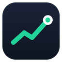

<div align="center">



# PricePin

**Live crypto prices on your Windows desktop.**

A fast, good-looking price widget that floats on your desktop, stays on top if you want it to, and updates the moment a trade happens.

[](../../releases/latest)
[](../../actions/workflows/build.yml)
[](LICENSE)


[Download](#download) · [Features](#features) · [Shortcuts](#keyboard-and-mouse) · [Privacy](#privacy) · [Build from source](#build-from-source) · [Changelog](CHANGELOG.md)

</div>

---

## Why PricePin

- **Real time.** Prices stream over WebSocket and change on every trade, not every minute.
- **Works anywhere.** If an exchange is blocked or down where you are, PricePin moves to the next one by itself.
- **Every coin.** Pick from every coin listed on Binance, Coinbase and Kraken, plus any token on a decentralised exchange by name or contract address.
- **Out of your way.** Stay on top, see-through, click-through, and lockable in place.
- **Private.** No account, no API key, no tracking. Your portfolio never leaves your PC.

## Features

### Widgets and layouts
- **Card list** that you drag anywhere and that snaps to screen edges (hold <kbd>Shift</kbd> to place it freely)
- **Ticker bar** that scrolls prices across the top or bottom of the screen, can reserve that space so maximised windows don't cover it, pauses while you hover it, and steps aside for full-screen apps
- **Up to 8 widgets at once**, each with its own coins, layout, size, opacity and position
- Stay on top, opacity from 20% to 100%, click-through and lock position
- Remembers where it was, and moves back on screen if a monitor is unplugged
- Only one copy runs at a time; launching it again shows the existing widget
- Sharp on high-DPI and mixed-scaling multi-monitor setups

### Live prices
- WebSocket feeds from **Binance, Coinbase and Kraken**, with automatic failover and REST polling as a last resort
- Reconnects on its own and notices a silent connection within 20 seconds
- Status pill showing LIVE, RECONNECTING, DELAYED or OFFLINE (hover it for details)
- Real coin logos, 24h sparklines, green and red flashes on every move, and a live 24h change
- Hover a coin for its 24h high, low and volume
- Prices in **USD, USDT, EUR, TRY or GBP**
- Change over the **last hour, 24 hours or 7 days**, per widget, with a sparkline to match

### Any token, on any chain
- Search by name or paste a **contract address** to add tokens from decentralised exchanges on Solana, Base, BNB Chain, Ethereum, Arbitrum and dozens more chains
- Prices from DexScreener every few seconds, charts and sparklines from GeckoTerminal
- Hover a token for its chain, market cap and liquidity; tiny, illiquid pools are left out of searches
- Works with alerts, the portfolio and the tray icon like any other coin

### Quick search
- Press <kbd>Ctrl</kbd>+<kbd>Alt</kbd>+<kbd>K</kbd> anywhere to look up any coin's live price and sparkline
- Built-in converter: type an amount of the coin or of your currency
- Open the chart, add it to a widget, set an alert or add it to your portfolio straight from there

### Charts and market
- **Coin charts:** double-click any coin for a 1D, 1W, 1M or 1Y chart that follows the live price. It has a crosshair, plus the range's high, low, change and volume
- **Market overview:** total market cap and its 24h change, BTC and ETH dominance, the Fear & Greed Index, and your best and worst coins today

### Alerts
- Alerts when a coin goes **above or below a price**, or **rises or falls by a percentage** in 24h
- Windows notifications with an optional sound, firing once or every time
- **Live price in the tray icon** for a coin you choose, green or red with the 24h move

### Portfolio and privacy
- Enter what you hold, and optionally what you paid, to see each holding's value, a live total, today's change and profit or loss
- **Privacy mode** blurs every amount for screen sharing and streaming while prices stay visible

### Look and feel
- Dark, light or follow-Windows theme, eight accent colours and three sizes
- Options to hide coin names, sparklines or headings
- **English and Türkçe**, following your Windows language or chosen in Settings
- Automatic background updates, start with Windows, and a tray icon

## Download

Get the **[latest release](../../releases/latest)**:

| File | For |
| --- | --- |
| `PricePin-win-x64-Setup.exe` | Most PCs. Installs for your user only (no admin rights), adds a Start menu shortcut and keeps itself up to date. |
| `PricePin-win-arm64-Setup.exe` | ARM PCs such as Snapdragon laptops. |
| `PricePin-win-x64-Portable.zip` | No install. Unzip anywhere and run `PricePin.exe`. This copy doesn't update itself. |

> [!NOTE]
> The installer isn't code-signed yet, so Windows SmartScreen may warn the first time. Click **More info → Run anyway**.

To remove PricePin, uninstall it from *Settings → Apps* like any other app. Your settings stay in `%AppData%\PricePin` in case you come back; delete that folder to remove them too.

**Want to try unreleased changes?** Every build on the [Actions tab](../../actions/workflows/build.yml) has a test installer under *Artifacts*.

## Getting started

1. Run the installer. A widget with the top coins appears and the tray icon shows up in the notification area.
2. **Right-click the widget** (or the tray icon) and open **Settings** to add, remove or reorder coins, change the currency, or switch to the ticker bar.
3. **Double-click a coin** to open its chart, where you can also set an alert or add it to your portfolio.

### Keyboard and mouse

| Action | How |
| --- | --- |
| Show or hide all widgets | <kbd>Ctrl</kbd>+<kbd>Alt</kbd>+<kbd>P</kbd> |
| Toggle click-through | <kbd>Ctrl</kbd>+<kbd>Alt</kbd>+<kbd>T</kbd> |
| Toggle privacy mode | <kbd>Ctrl</kbd>+<kbd>Alt</kbd>+<kbd>H</kbd> |
| Quick search | <kbd>Ctrl</kbd>+<kbd>Alt</kbd>+<kbd>K</kbd> |
| Change opacity | <kbd>Ctrl</kbd> + mouse wheel over a widget |
| Place freely without snapping | Hold <kbd>Shift</kbd> while dragging |
| Open a coin's chart | Double-click the coin |
| Show or hide from the tray | Left-click the tray icon (right-click for the menu) |

All four global shortcuts can be changed in *Settings → General*.

## Privacy

PricePin has no account, no telemetry and no analytics. It only talks to the public price and logo sources listed below. Your coins, alerts and holdings are stored in a settings file on your PC and nowhere else.

## Data sources

| Source | Used for |
| --- | --- |
| Binance | Live prices (WebSocket), 24h history and charts. USD is shown using USDT pairs. Not available in some regions, so PricePin moves on automatically. |
| Coinbase | Live prices (WebSocket), REST fallback, 24h history and charts |
| Kraken | Live prices (WebSocket), 24h history and charts |
| [cryptocurrency-icons](https://github.com/spothq/cryptocurrency-icons) (CC0) | Coin logos. Popular coins are bundled; others download once and are cached. |
| CoinGecko | Logos for newer coins, plus market cap and dominance from its public `/global` endpoint |
| [alternative.me](https://alternative.me/crypto/fear-and-greed-index/) | Fear & Greed Index |
| [DexScreener](https://dexscreener.com) | Prices, search and logos for tokens on decentralised exchanges |
| [GeckoTerminal](https://www.geckoterminal.com) | Charts and sparklines for tokens on decentralised exchanges |
| Coinbase, [open.er-api.com](https://www.exchangerate-api.com/docs/free) | Dollar exchange rates, to show DEX token prices in EUR, TRY or GBP |

All of these are public endpoints, so no account or API key is needed. To check which sources work from your network:

```powershell
dotnet run --project tools/FeedProbe -- 15 BTC ETH SOL
```

## Files

| Path | What's there |
| --- | --- |
| `%AppData%\PricePin\settings.json` | Your settings, alerts and holdings. Delete it to reset everything. |
| `%AppData%\PricePin\crash.log` | Unexpected errors, if any |
| `%LocalAppData%\PricePin` | Cached logos and coin lists |

## Build from source

Requires the [.NET 10 SDK](https://dotnet.microsoft.com/download) on Windows 10 or 11.

```powershell
git clone https://github.com/4U0/PricePin-Next.git
cd PricePin-Next
dotnet run --project src/PricePin
```

Run the tests:

```powershell
dotnet test
```

Single-file release build:

```powershell
dotnet publish src/PricePin -c Release -r win-x64 --self-contained `
  -p:PublishSingleFile=true -p:IncludeNativeLibrariesForSelfExtract=true -p:EnableCompressionInSingleFile=true
```

### Project layout

```text
src/PricePin          WPF app: windows, view models, controls, themes, strings
src/PricePin.Core     Feeds, failover, alerts, portfolio, charts and settings (no UI)
tests/                Unit tests for PricePin.Core and the translations
tools/FeedProbe       Console tool that checks which data sources work from your network
docs/                 Release guide and images
```

**Tech:** C# · .NET 10 · WPF · [CommunityToolkit.Mvvm](https://github.com/CommunityToolkit/dotnet) · [H.NotifyIcon](https://github.com/HavenDV/H.NotifyIcon) · [Velopack](https://velopack.io) for the installer and updates

## Contributing

Issues and pull requests are welcome. Every pull request is built and tested on Windows, and gets a test installer you can try from the run's *Artifacts*.

### Translating

PricePin's text lives in [`src/PricePin/Strings`](src/PricePin/Strings). To add a language:

1. Copy `Strings.en.xaml` to `Strings.<code>.xaml`, for example `Strings.de.xaml`.
2. Translate the text between the tags, keeping placeholders like `{0}` as they are.
3. Add the language to `Loc.Languages` in [`Services/Loc.cs`](src/PricePin/Services/Loc.cs).

The tests check that every translation has the same keys and placeholders as English.

### Releasing

See [docs/RELEASING.md](docs/RELEASING.md).

## Roadmap

- [x] Widget, stay on top, opacity, click-through and tray
- [x] Live feeds from Binance, Coinbase and Kraken with failover
- [x] Settings window, coin picker, currencies, themes and sizes
- [x] Ticker bar, multiple widgets and global hotkeys
- [x] Installer, auto-update, English and Turkish
- [x] Price alerts and live price in the tray icon
- [x] Portfolio and privacy mode
- [x] Coin charts and market overview
- [ ] Code signing and a winget listing
- [x] Any token by contract address, quick search and converter, 1h/7d change
- [ ] News headlines about your coins in the ticker bar
- [ ] Whale trades and liquidations radar
- [ ] Exchange price compare
- [ ] Stocks and forex

## License

[MIT](LICENSE). PricePin isn't financial advice, and prices may be delayed or wrong. Always check with your exchange before you trade.
